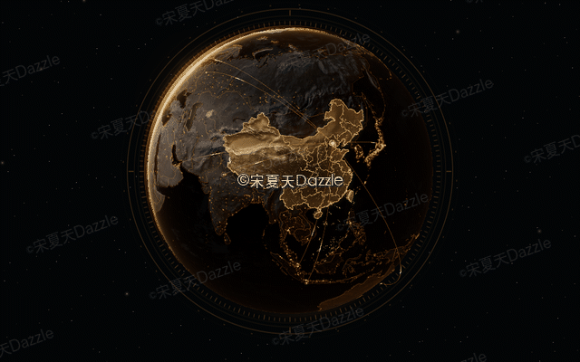
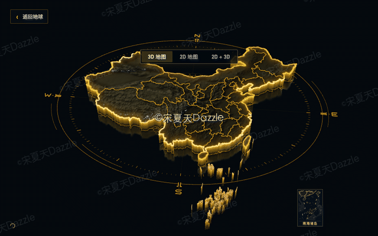
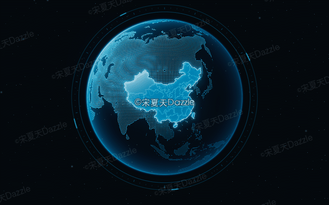
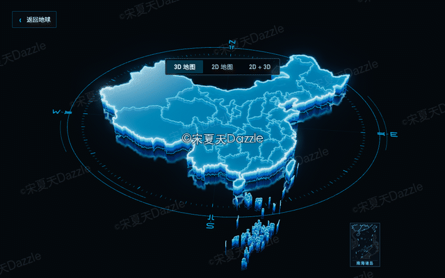
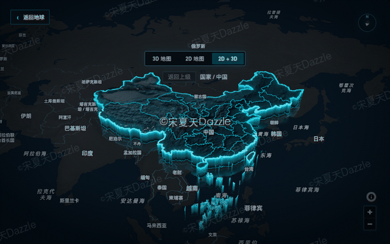

# Three Scope Map 3.0 · Earth and Geographic Map Skill

A geographic visualization skill with runnable Vue templates for Three.js Earth,
administrative 3D maps, MapLibre 2D maps, 2D + 3D overlays, and contour terrain.

> **3.0 授权提示：未经作者事先书面许可，不得将本项目的 Skill、代码、模板、
> 组件或其修改版封装、集成或托管到自有或第三方平台，作为可复用的地球/地图
> 能力对外收费提供。** 收费整体中的免费功能、会员订阅、付费积分、按次调用、
> 捆绑或安排其他主体代收费用，均适用限制；不交源码、改名换皮或AI辅助改写后
> 仍含本项目受保护内容的，不自动获得豁免。
> 普通业务项目及客户定制开发、交付可按 [LICENSE](LICENSE) 使用；以定制开发
> 名义建设收费地图平台仍须另行获得书面许可。

## 效果预览 / Motion previews

作者全平台ID：宋夏天Dazzle  
公众号：送你整个夏天

以下动图录制自内置模板的实际运行效果，支持循环播放。

| 地球效果 | 地图效果 |
| --- | --- |
| **3.0 实体地球** | **地形玻璃 3D 地图** |
|  |  |
| **点阵全息地球 · 蜂窝扫描** | **纯玻璃 3D 地图** |
|  |  |
| **蜂窝全息地球 · 网格扫描** | **2D + 3D 地理叠加** |
|  |  |

## Install or upgrade / 安装与升级

The installation and project-copy tools require Python **3.9 or newer** and use
only the Python standard library.

Run from this repository root, or from the directory containing the extracted
`three-scope-map/` folder:

```bash
python3 three-scope-map/scripts/install_skill.py
```

默认安装到 `~/.codex/skills/three-scope-map`。升级时，脚本先将旧 Skill 完整备份到
skills 目录之外的 `~/.codex/skill-backups/`，再整目录替换，避免合并残留旧文件。
旧版本的定制保留在备份中，不会自动迁回；需要时先比较，再按新版本接口迁移。
不要用 `cp -R` 向已有 Skill 目录合并升级。

自定义位置可使用 `--source <skill-folder>`、`--target <destination>` 和
`--backup-dir <external-backup-parent>`。ZIP 内的
[中文快速说明](three-scope-map/README.md)可独立阅读。

## Choose a style and color

| Request | Earth and matching 3D map |
| --- | --- |
| `用 2.0 风格` | Classic Earth and classic 3D map. |
| `用 3.0 实体地球` | Photographic FUI Earth and textured terrain-glass map. |
| `用 3.0 全息地球` | Regular-dot hologram Earth and smooth-glass map. Request a honeycomb globe explicitly to change its texture. |

New Earth or administrative-3D projects default to **3.0 entity Earth / 实体地球**, with an amber palette.
Hologram projects start with a glacier-blue palette. Existing projects keep their
current style and color unless a change is requested.

Specify a color by name or HEX value. Recoloring preserves the selected style,
materials, geographic data and navigation.
Entity and hologram Earth both support grid or honeycomb scans independently of
the globe texture: `扫光改成蜂窝扫描` retains the current dot/hex pattern.

### Create a project

Create a complete, runnable FUI project in a new or empty directory:

```bash
python3 three-scope-map/scripts/create_map_project.py ./my-map
cd my-map
npm ci
npm run dev
```

`--preset fui` is the default; `--preset classic` selects the complete 2.0 family.
The script refuses a non-empty destination, copies the complete template and its
license notices, and does not install packages or access npm automatically.

Natural-language invocation:

```txt
使用 three-scope-map，创建一个 3.0 实体地球项目，整体蓝色。
```

### Change an existing project

```txt
使用 three-scope-map，把当前地图换成 3.0 全息风格，保留主色和数据。
```

The matching 3D map follows the chosen Earth style. Map-only projects can use the
same map materials without adding an Earth entrance.

### More examples

```txt
整体改成 #2AF7FF。
在现有 2D 底图上叠加 3D 地图，保留下钻和返回。
把地图范围从浙江切到江苏，保留配色和交互。
增加独立等高线模式，使用真实 DEM。
```

## Features

- **Earth entrances:** classic, photographic and holographic styles, with HUD,
  lighting, animated scans and Earth-to-map navigation.
- **Administrative 3D maps:** terrain-glass and smooth-glass surfaces, extruded
  geometry, province boundaries, reflections and region selection.
- **2D maps and overlays:** MapLibre basemaps, standalone renderer switching,
  and geographic 3D overlays sharing the basemap camera and WebGL context.
- **Contour terrain:** an independent terrain mode built from elevation data.
- **Geographic navigation:** world, country, province, city and district/county
  levels, subject to available administrative data. China scope includes a fixed
  screen-space South China Sea inset.
- **Theme control:** one primary color across Earth, maps, HUD and interaction
  effects, with separate controls for map materials and scan effects.

## Templates and integration

| Style | Complete Vue template |
| --- | --- |
| 3.0 entity / hologram | [fui-earth-vue](three-scope-map/assets/templates/fui-earth-vue/README.md) |
| 2.0 classic | [songsummer-earth-vue](three-scope-map/assets/templates/songsummer-earth-vue/README.md) |

Use the complete template, including its data, textures, helpers and configuration.
Both templates require Node.js `^20.19.0` or `>=22.12.0` and include dependency lockfiles.
Each template already includes `LICENSE`, `NOTICE`, `LICENSES/` and
`THIRD_PARTY_NOTICES.md`; preserve them with the project.

Build a generated project with `npm run build`.

Both templates' `src/App.vue` files demonstrate the available styles and effects.
Integrate the selected family's Earth or `ChinaMap.vue` host into business layouts.
Keep the `3D 地图 / 2D 地图 / 2D + 3D` selector by default; hide it only on an
explicit request to remove switching or keep a single view. Geographic drilldown,
back and Earth-return controls remain available. Style, color, material and effect
toolbars are opt-in. Standalone 2D or contour tasks do not need unrelated renderers.
See the template READMEs for component entry points.

## Network and data / 联网范围

The default 2D and 2D + 3D basemap uses **OpenFreeMap** online, including its style,
tiles, glyphs and sprites. The administrative data adapter bundles China and
Zhejiang; other provinces and deeper city/district drilldown load from
`geo.datav.aliyun.com` on demand. Earth textures and the bundled geographic files
are local assets, but the default project is not a fully offline map.

For an offline or internal-network deployment, configure an available basemap
provider and its supporting resources in `vectorMapConfig.ts` /
`vectorMapProvider.ts`, and supply the required administrative levels through
`mapDataAdapter.ts`. Retain each provider's attribution and applicable data terms.
`npm ci` also needs access to the configured package registry or a prepared local cache.

Further documentation:

- [3.0 API and capability matrix](three-scope-map/references/v3-api.md)
- [2D + 3D overlay integration](three-scope-map/references/map-3d-overlay.md)
- [Performance and validation](three-scope-map/references/performance-pipeline.md)
- [Changelog](CHANGELOG.md)

## Version status

**3.0.0 source release: 2026-11-12.** Local technical verification used macOS
and Chromium; other operating systems, browsers and physical GPUs have not been
verified. See the [validation record](three-scope-map/validation/3.0.0/record.json)
and [citation metadata](CITATION.cff).

Some bundled geographic data and legacy textures still have unresolved upstream
reuse rights. See the [current asset review](three-scope-map/validation/3.0.0/asset-clearance-current.json)
and [third-party notices](THIRD_PARTY_NOTICES.md). The author-owned code license
does not grant commercial or redistribution rights to third-party materials.
Users must obtain the permissions required for their own use, deployment or
redistribution; a public download or working demo does not establish those
rights. Source publication does not clear the bundle's unresolved asset rights.

## License and attribution / 授权与署名

3.0 自有代码、Skill、模板和文档采用
[Summer Platform Restriction License 1.0](LICENSE)，属于带用途限制的源码可用授权，
不宣称为 GPL 或 OSI 开源许可证。

- **允许：** 学习、企业内部使用、普通商业业务项目及客户定制开发、交付，并可为
  开发、部署、维护等服务收费；不包括下述受限平台用途。
- **未经作者事先书面许可，禁止：** 将本项目全部、部分或修改版作为可复用的
  地球/地图能力，封装、集成或托管到收费平台、SaaS、低代码/可视化平台、
  AI/Agent 平台、API，或作为 Skill、插件、SDK、组件、模板、资源包销售及提供
  付费访问。独立销售的渲染、展示组件同样适用。
- **限制不因以下方式自动豁免：** 托管但不交源码、收费整体中的免费功能、捆绑
  收费、代收费用、改名换皮，或改写后仍保留受保护内容。普通业务应用不因收费
  或订阅制就自动成为受限平台；完整判断标准以 [LICENSE](LICENSE) 为准。
- **保留署名和许可：** 分发源码时保留 [LICENSE](LICENSE)、[NOTICE](NOTICE)、
  [LICENSES/](LICENSES/) 和 [第三方声明](THIRD_PARTY_NOTICES.md)，明确标注修改版。
  历史已合法授予的 GPL 权利继续有效，第三方材料仍遵循各自条款。

The 3.0 author-owned material uses a source-available license with a platform-resale
restriction. Ordinary business use and client-specific delivery are permitted;
paid reusable Earth/map platforms and resource offerings require prior written
author permission. Hosted use, bundling and renamed or modified distributions do
not automatically avoid that requirement. The complete scope is defined by
[LICENSE](LICENSE); it does not revoke historical GPL grants or replace
third-party terms.

This is the original repository by **宋夏天Dazzle**. Retain this attribution in
code or documentation for forks, derivatives, tutorials and redistribution;
no permanent application watermark is required:

```txt
Based on three-scope-map-skill by 宋夏天Dazzle.
作者全平台ID：宋夏天Dazzle
公众号：送你整个夏天
Original repository: https://github.com/songsummer920-dazzle/three-scope-map-skill
```
