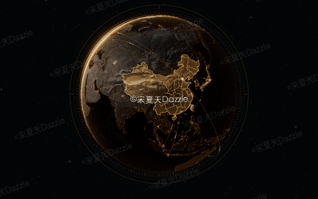
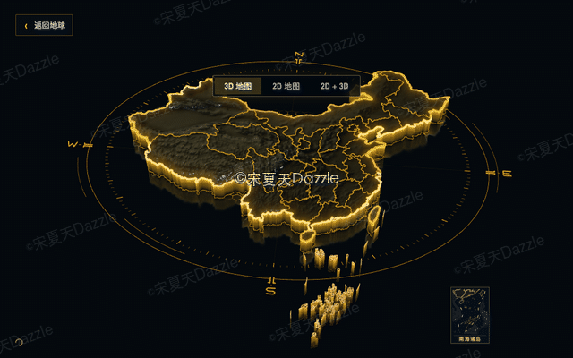
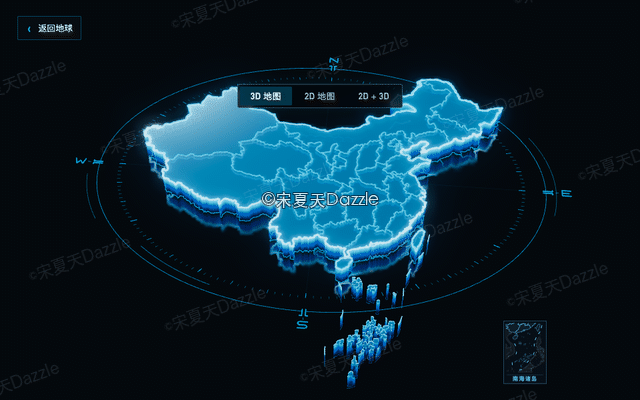
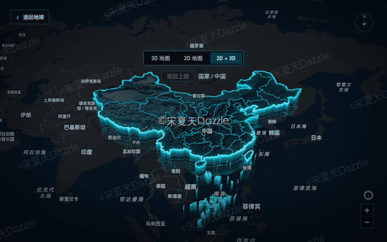

# Three Scope Map 3.0 · 中文快速说明

这是可安装的 Codex 地球与地理地图 Skill，内含完整 Vue 3 + TypeScript + Vite
模板：地球入口、行政区 3D 地图、MapLibre 2D、2D + 3D 叠加和独立等高线地形。
**3.0.0 源码发布：2026-11-12。**

## 效果预览

作者全平台ID：宋夏天Dazzle  
公众号：送你整个夏天

以下动图录制自内置模板的实际运行效果，支持循环播放。

| 地球效果 | 地图效果 |
| --- | --- |
| **3.0 实体地球** | **地形玻璃 3D 地图** |
|  |  |
| **点阵全息地球 · 蜂窝扫描** | **纯玻璃 3D 地图** |
|  |  |
| **蜂窝全息地球 · 网格扫描** | **2D + 3D 地理叠加** |
|  |  |

## 安装或升级 Skill

解压 ZIP 后，进入本 `three-scope-map/` 目录运行：

安装工具只需 Python **3.9 或更新版本**，无需额外安装 Python 依赖。

```bash
python3 scripts/install_skill.py
```

默认安装到 `~/.codex/skills/three-scope-map`。若已有旧版本，脚本先把旧 Skill
完整备份到 skills 目录之外的 `~/.codex/skill-backups/`，再整目录替换；不要用
`cp -R` 合并升级。旧定制会保留在备份中，不会自动迁回；先比较，再按新版本
接口迁移。可用 `--source <skill目录>`、`--target <安装目录>`、
`--backup-dir <外部备份父目录>` 指定位置。

## 样式与颜色配置

| 调用示例 | 地球与配套 3D 地图 |
| --- | --- |
| `使用 three-scope-map，用 3.0 实体地球。` | 实体/写实 FUI 地球 + 地形玻璃地图，默认琥珀色。 |
| `使用 three-scope-map，用 3.0 全息地球。` | 规则细点全息地球 + 光滑玻璃地图，默认冰蓝色；明确指定蜂窝地球或蜂窝纹理时切换地球图案。 |
| `使用 three-scope-map，用 2.0 风格。` | 经典地球 + 经典 3D 地图。 |

新地球或行政 3D 项目未指定风格时使用 3.0 实体；已有项目保持原风格和主色，
地图单独使用时无需添加地球入口。换色示例：`整体改成 #2AF7FF。`
换色保留当前风格、材质、数据和导航。
实体与全息均支持 `扫光改成蜂窝扫描。`；该指令仅切换扫描效果，保留地球原有纹理。

## 创建并运行项目

要求 Python **3.9 或更新版本**，以及 Node.js **`^20.19.0` 或 `>=22.12.0`**。
在本 Skill 目录中执行：

```bash
python3 scripts/create_map_project.py ../my-map --preset fui
cd ../my-map
npm ci
npm run build
npm run dev
```

`--preset fui` 可省略；2.0 使用 `--preset classic`。脚本拒绝非空目标目录，复制
完整模板及 `LICENSE`、`NOTICE`、`LICENSES/`、`THIRD_PARTY_NOTICES.md`，不会自动
执行 npm 或下载依赖。也可用 `--source <skill目录>` 指定模板来源。

## 业务项目接入

两套模板的 `src/App.vue` 均为演示入口；FUI 的样式、颜色、材质和效果按钮用于
预览能力。业务项目应把组件接入自身布局，按需求配置选定风格，保留原样式代码：

- 3.0 地球入口：`src/components/map/FuiEarth.vue`，配套方案在
  `fuiMapPresentation.ts` 的 `FUI_SCENE_PRESETS` 中。
- 2.0 地球入口：`src/components/map/EarthChinaMap.vue`。
- 单独地图：按所选方案接入 `ChinaMap.vue` / `ZhejiangThreeMap.vue`、
  `VectorMap.vue` 或 `ContourMap.vue`，并保留对应的数据、纹理和辅助模块。

正常接入地球或行政 3D 地图时，默认保留「3D 地图 / 2D 地图 / 2D + 3D」切换按钮；
仅在明确要求隐藏切换控件或保留单一视图时关闭。仅指定 3D 为初始视图时，
仍保留模式切换。FUI 的 `EarthChinaMap.vue` 已默认开启 `show-view-switch`，
业务接入时保持开启；只做地图也优先使用 `ChinaMap.vue` 宿主保留模式切换与地理导航。
模板、颜色、材质、扫光等演示工具条仍只在明确要求时添加；下钻、返回上级和返回
地球继续保留。明确的独立 2D 或独立等高线任务无需额外加入无关渲染器。
两套模板的 [FUI README](assets/templates/fui-earth-vue/README.md) 和
[2.0 README](assets/templates/songsummer-earth-vue/README.md)说明了具体入口；详细集成见
[3.0 API](references/v3-api.md)、[FUI](references/fui-earth.md)和
[2.0 模板](references/one-to-one-template.md)。

## 联网范围与离线部署

默认 2D 和 2D + 3D 底图连接 **OpenFreeMap**，样式、瓦片、字形和图标等资源需要
联网。行政数据 adapter 随包内置中国和浙江；其他省份及进一步的市、区县下钻
默认按需请求 `geo.datav.aliyun.com`。随包地球纹理和地理文件可本地加载；默认
项目仍需联网。

离线或内网部署需在 `src/components/map/vectorMapConfig.ts` /
`vectorMapProvider.ts` 配置可用底图 provider 及配套资源，并在
`mapDataAdapter.ts` 提供所需层级的行政数据。保留对应署名与数据条款。
`npm ci` 需要访问配置的包源或使用已准备的本地依赖缓存。

## 授权、署名与当前状态

自有代码、Skill、模板和文档采用 [Summer Platform Restriction License 1.0](LICENSE)：
允许学习、内部使用、普通业务项目及客户定制开发、交付；未经作者事先书面许可，
不得把本项目或其修改版作为可复用地球/地图能力在收费平台、SaaS、API、Skill、
插件、SDK、组件、模板或资源包中销售或提供付费访问。收费整体中的免费入口、
托管不交源码、捆绑收费、改名换皮或保留受保护内容的 AI 改写不自动豁免；普通
业务应用不因收费或订阅制就自动属于禁止范围。完整范围以 [LICENSE](LICENSE) 为准。

保留随包 [NOTICE](NOTICE)、[LICENSES/](LICENSES/) 和
[THIRD_PARTY_NOTICES.md](THIRD_PARTY_NOTICES.md)。历史 GPL 已授予的权利继续有效；
第三方软件、地理数据和素材仍遵循各自条款。本项目是带用途限制的源码可用授权。

自有代码许可不包含第三方地图数据、底图服务、影像或纹理的商业授权。使用者应按
实际使用、部署和分发场景自行核实上游条款，取得所需许可，并履行署名、费用及
使用范围要求。公开下载或示例可运行不代表已取得商业授权；第三方许可也不替代
本项目对受限平台封装及转售要求的书面许可。

分享、教程、衍生及再分发请保留公开作者署名和原项目链接，不要求最终界面常驻水印：

```text
Based on three-scope-map-skill by 宋夏天Dazzle.
作者全平台ID：宋夏天Dazzle
公众号：送你整个夏天
Original repository: https://github.com/songsummer920-dazzle/three-scope-map-skill
```

当前有 [第三方资产来源及再分发核验未完成](validation/3.0.0/asset-clearance-current.json)，
来源记录不构成商业使用或再分发授权；使用者的商业使用许可与随包分发权利分别核实。
本版已完成 macOS + Chromium 本地技术验证，详见
[验证记录](validation/3.0.0/record.json)。[引用元数据](CITATION.cff)记录版本、作者、
源码发布日期、仓库地址及 `v3.0.0` 标签的许可 URL。源码发布不代表第三方素材
的商业使用或再分发授权已经核实完成。
